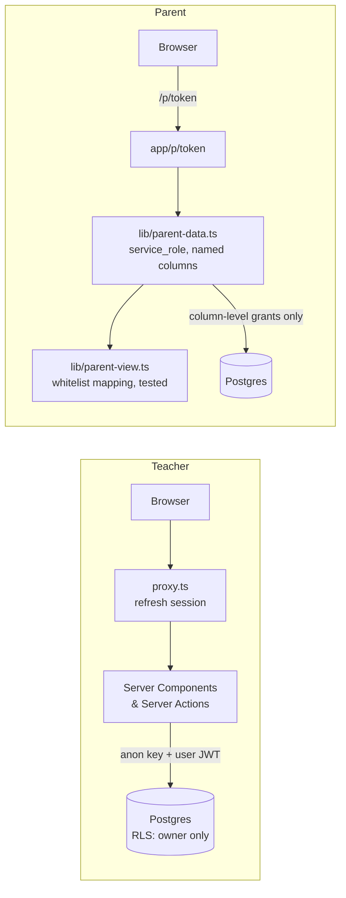

# Tutor Baseline

Progress tracking for a one-person tutoring practice: every student has a dated plan, and the app answers one question every morning — **who is behind, by how much, and how many extra hours will it take to catch up?** Parents get a read-only link instead of a weekly status message.

**Live demos (synthetic data, no login), in English, 日本語 or 中文:**
[analytics](https://nextjs-boilerplate-lemon-nine-15.vercel.app/demo/analytics?lang=en) ·
[weekly schedule](https://nextjs-boilerplate-lemon-nine-15.vercel.app/demo/schedule?lang=en)

Next.js 16 · TypeScript · Supabase (Postgres, RLS, passkeys) · Tailwind CSS · Vitest · Vercel

---

## The problem

I tutor a handful of students, two of them heading into entrance exams. I had been tracking them on a single page that could show progress but had two hard limits:

- **Parents couldn't see it.** Every week I wrote each family the same kind of update by hand.
- **The data had no structure.** Cancellations, reschedules and after-lesson notes had nowhere to go, so the patterns in them were invisible.

The useful idea in that page was a *baseline*: a plan made of dated checkpoints, each with a concrete pass criterion ("three past papers done and every lost point categorised", not "finish past papers"). This project keeps that idea and builds the missing structure around it.

## How it works

| For | What they get |
|---|---|
| Me (the only login) | A dashboard sorted by risk: expected vs actual position on each plan, days ahead/behind, catch-up hours, days to the exam, and a warning when lessons keep getting cancelled. A 30-second after-lesson log. |
| Parents (no login) | An unguessable link to one page: the goal, the checkpoints I chose to share, and a one-line summary of recent lessons. |
| Analysis | Mood trend per student, on-time rate of checkpoints, and whether checkpoints whose run-up had a cancelled lesson are finished on time less often. |

## Design decisions

### 1. Progress is a position, not a count
`lib/progress.ts` sorts dated checkpoints by due date and compares **how many are due by today** with **the position of the last completed one**. Skipping a box doesn't hide progress, and completing one early shows up as "ahead".

Two edge cases turned into explicit rules, each with a test:
- A checkpoint due *today* that isn't ticked yet is **on track**, not "0 days behind" — the lesson may simply be this evening.
- Sorting uses the due date, not the manual sequence number, because placeholder dates (an exam date not yet announced) can later move out of sequence order; sorting by sequence would then produce *negative* days behind.

"Today" is always computed in Asia/Tokyo; the server runs in UTC, which is yesterday until 9 a.m. local time.

### 2. Cancellations are data
A lesson is `done`, `canceled` or `rescheduled`; nothing gets deleted to mean "didn't happen". Two missed lessons in a row raise a flag on the dashboard: in my experience that is the earliest sign that a fixed weekly slot is quietly becoming "on demand". The analysis page tests the hunch: checkpoints are split by whether a lesson was missed during their run-up, and the on-time rates are compared.

### 3. What parents see is decided by the schema, not by remembering
- Each lesson has **two text fields**: an internal `note` and a `parent_summary`. They are separate columns, labelled and styled differently in the form, and an empty summary hides the lesson from parents entirely.
- Checkpoints are **hidden from parents by default** (`parent_visible = false`). My own to-dos live in the same plan ("send the rescheduling proposal"), so opt-in is the safe direction: forgetting to tick a box means a parent sees one item less, never an internal note.
- Parent-facing progress is computed **only over parent-visible checkpoints**, and shown as counts plus neutral wording. My to-dos can't make a child look behind, and parents never see days-behind or catch-up hours.

### 4. The parent page doesn't go through RLS — on purpose



Opening RLS to anonymous users would mean writing policies that are hard to reason about. Instead the parent page renders on the server with the service role, and three layers keep it narrow:

1. **Database grants** — `service_role` can read only the columns the page uses, and write only the two things a parent can do: request an extra lesson and take a day off (column-level grants from `0011` on; `npm run check:db` verifies them).
2. **Named columns** — `lib/parent-data.ts` never selects internal columns such as `note` or `risk_note`.
3. **A whitelist mapping** — `lib/parent-view.ts` copies allowed fields one by one. Its tests feed in rows containing internal fields and assert that none of them reach the output; I checked that the test fails when a field is deliberately leaked.

`lib/supabase/admin.ts` starts with `import 'server-only'`, so importing the service-role client from browser code is a **build error**, not a code-review item. Unknown, disabled and malformed tokens all return the same 404, and a link can be rotated at any time.

### 5. RLS is not enough on its own
This Supabase project did not grant table privileges to the API roles by default. A check that only confirms "anonymous users see nothing" would have passed; the check that the **owner does see** their data (4 students / 24 checkpoints / 9 slots) failed with `permission denied` — before any UI existed. Grants and policies now live in the same migration, and anonymous requests are refused at the privilege layer before RLS is even consulted.

### 6. Authentication for exactly one user
Sign-ups are disabled. Passkeys (Face ID / Touch ID through iCloud Keychain) are the main login; a magic link stays as the fallback for new devices. Signing out affects only the current device.

### 7. Charts that survive colour-blindness and dark mode
The analysis page uses one blue ramp meaning "needs attention". A red/green status palette was tried first and rejected after validation: the green and red were almost indistinguishable under deuteranopia (ΔE 4.1 against a target of 8). The dark-mode ramp is chosen separately, not inverted, and every chart has a table with the same numbers.

The demo data comes from a seeded pseudo-random generator, kept in memory. Screenshots and the public demo never touch a real student's record.

### 8. Three languages, and the parent page has its own
The UI is available in Chinese, English and Japanese. The tutor picks a language for their own pages; each student's parent page has a separate setting, because families don't necessarily read the tutor's language, and changing your own language must never change what a parent sees.

- All UI text lives in typed dictionaries (`lib/i18n/messages/*.ts`), one file per area with the three languages side by side. `defineMessages({ zh, en, ja })` takes its shape from one language and makes a missing key or a mismatched parameter in another language a **type error**, so a forgotten translation fails the build instead of rendering a blank.
- URLs don't change with the language: parent links that were already sent keep working.
- Data is not translated: names, checkpoint titles and notes stay in the language they were written in. Computed labels (for example the tags on a statement row) are stored as codes and translated when shown.
- The notification email to the tutor uses the tutor's language; the demo pages follow `?lang=` or the browser.

## Data model

| Table | Purpose | Notable choices |
|---|---|---|
| `students` | One row per student | `rate_per_hour` is nullable: *null* means an agency student, excluded from income. `risk_note` is internal. `parent_token` + `parent_enabled` control the parent link. |
| `checkpoints` | The baseline | `seq` orders items that share a date; `due_date` null = ongoing item (not counted); `date_tbd` flags placeholder dates. |
| `lessons` | After-lesson log | `status` keeps cancellations; `note` vs `parent_summary`; `mood` (1 smooth / 2 stuck / 3 revisit). |
| `homework` | Assigned work and result | Schema only for now. |
| `slots` | Weekly availability grid | Weekday × four 2-hour bands. |

Dates are `date` columns and `YYYY-MM-DD` strings with no time zone; money is integer yen. The whole schema, with its policies and grants, is one file: `supabase/migrations/0001_schema.sql`.

## Project layout

```
app/(app)/          signed-in pages: dashboard, students, analytics, account
app/p/[token]/      parent page (no login)
app/demo/            public demos (analytics, schedule) with synthetic data only
lib/progress.ts     baseline calculation            (tested)
lib/parent-view.ts  parent whitelist mapping        (tested)
lib/analytics.ts    analysis calculations           (tested)
lib/schedule.ts     weekly rules → lessons, billing   (tested)
lib/booking.ts      parent booking / leave           (tested)
lib/metrics.ts      grades and stage targets         (tested)
lib/parent-data.ts  the only data path to the parent page
lib/i18n/           languages: locale rules (tested) and the UI dictionaries
proxy.ts            session refresh + sign-in redirect (Next.js 16 "middleware")
mcp/server.mts      Claude Desktop assistant (MCP), same RLS as the web app
supabase/           schema (policies and grants included) and a fictional seed
scripts/check-db.mjs read-only check of the grants against a live database
docs/               assistant and backup setup
```

## Running it

```bash
npm install
cp .env.example .env.local        # Supabase URL, publishable key, secret key
npx supabase link --project-ref <ref>
npx supabase db push              # apply the schema
npm run dev
npm test
```

Create your user in the Supabase dashboard first, then run `supabase/seed.sql` in the SQL editor for sample data. Passkeys only work on the domain configured as the relying party; local development uses the magic link.

## Since the first version

- Weekly schedules are stored as rules; a lesson on a given day is computed, and only what actually happened (taught, leave, extra lesson) is written. Each lesson keeps a snapshot of the hourly rate, so price changes never rewrite the past.
- Monthly statements, printable and optionally shared on the parent page; an income page.
- Parents can request an extra lesson or take a day off from their page; the request is re-checked on the server and the teacher gets an email.
- Per-student grade metrics with stage targets.
- A Claude Desktop assistant (MCP) that logs lessons as the teacher, through the same RLS as the web app, with no delete tool.
- The whole UI in Chinese, English and Japanese, with a separate language for each parent page.

## Next

- Revisit the analysis once a few months of real lessons exist; the metrics are fixed, the presentation is expected to change.

All student data in this repository (seed and tests) is fictional, and the demo data is synthetic. This repository is a snapshot of the private working repository, published as a single commit.
